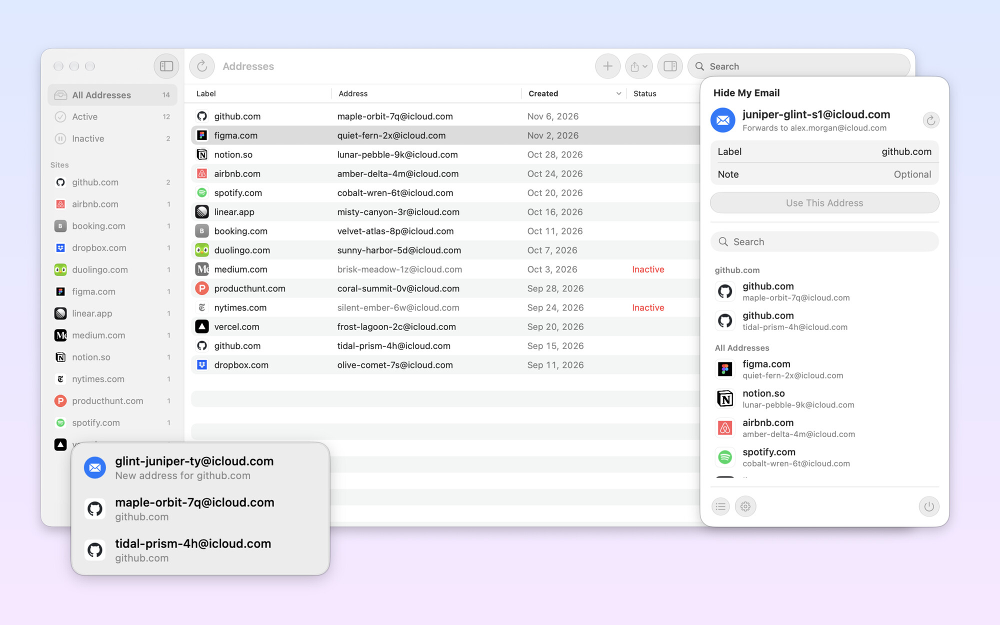
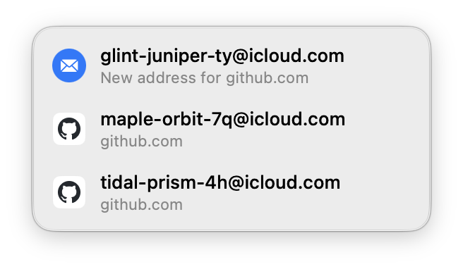
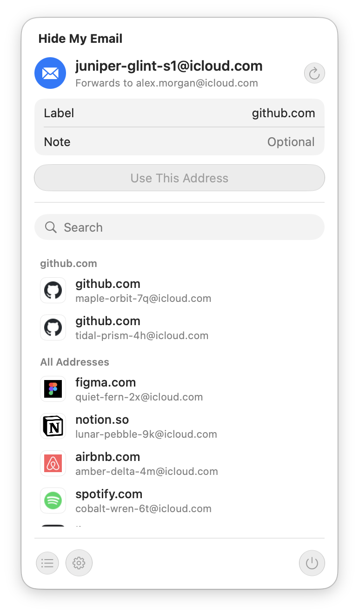

# iCloud Hide My Email for Mac and browsers

[Hide My Email](https://support.apple.com/en-us/HT210425) is the iCloud+ service that gives every site its own random address forwarding to your inbox. Safari offers one whenever you sign up somewhere; this project brings the same experience to every other browser and app.

<p align="center">

</p>

## Hide My Email for macOS

A native menu bar app that works in Zen, Firefox, Arc, Chrome and any other app with text fields, no browser extension required.

- **Suggestions in email fields.** Focus an email field anywhere and a Liquid Glass panel offers a fresh address for the site, plus the ones you already use there. One click fills the field.
- **⌃⌥E** creates an address labelled after the current site and types it in.
- **Menu bar** for generating, labelling and searching addresses, and pasting them into the app you came from.
- **Addresses window** with every address on the account, including ones made in Safari or on other devices: per-site filters with real site icons, label and note editing, bulk deactivate, reactivate and delete, CSV and JSON export.
- **Sign-in through your browser**, so passkeys and two-factor authentication work as usual. The app never asks for your Apple ID password and needs no Full Disk Access.

<p align="center">


</p>

Download `HideMyEmail.dmg` from the [latest release](https://github.com/SergeiNikolenko/icloud-hide-my-email-browser-extension/releases/latest). It needs macOS 26 or later and an iCloud+ subscription, and updates itself. See [`macos/`](macos/README.md) for setup and build instructions.

## Browser extension

[](https://github.com/dedoussis/icloud-hide-my-email-browser-extension/actions/workflows/tests.yml)

The extension comes from [dedoussis/icloud-hide-my-email-browser-extension](https://github.com/dedoussis/icloud-hide-my-email-browser-extension). This fork restyles it after native macOS materials, with light and dark themes, an address manager with search, editing and deletion confirmation, and a field button that no longer shifts page layouts. It also fixes autofill in iframes and repeated fields, replies to the tab that asked, keeps the session through network errors and drops the broad `tabs` permission.

The upstream extension has been tested on:

- [Chrome](https://chrome.google.com/webstore/detail/icloud-hide-my-email/omiaekblhgfopjkjnenhahfgcgnbohlk)
- [Firefox](https://addons.mozilla.org/en-US/firefox/addon/icloud-hide-my-email/)
- [Brave](https://chrome.google.com/webstore/detail/icloud-hide-my-email/omiaekblhgfopjkjnenhahfgcgnbohlk)
- Microsoft Edge

Note that the extension _should_ work on any browser that implements the [extension API](https://developer.chrome.com/docs/extensions/reference/) supported by Chromium-based browsers.

_Disclaimer: This extension is not endorsed by, directly affiliated with, maintained, authorized, or sponsored by Apple._

<p align="center">

</p>

<p align="center">

</p>

### Features

- Simple pop-up UI for generating and reserving new Hide My Email addresses
- Ability to manage existing Hide My Email addresses (including deactivation, reactivation, and deletion)
- Autofilling on any HTML input element that is relevant to email
- Quick configuration of Hide My Email settings, such as the Forward-To address, through the Options page of the extension

### Options

#### Address autofilling

The extension can be configured to

1. show an autofill button on input field focus
2. show a context menu item when right-clicking on input fields

<p align="center">

</p>

<p align="center">

</p>

You can enable/disable any of the autofilling mechanisms through the Options page of the extension.

### Develop

This extension is entirely written in TypeScript. The UI pages of the extension (e.g. Pop-Up and Options) are implemented as React apps and styled with TailwindCSS.

#### Dev environment

Development was carried out in an environment that matches the following Docker image:

```Dockerfile
FROM node:25.1.0-alpine3.22

RUN apk add --update --no-cache g++ make python3

ADD . /opt/extension

WORKDIR /opt/extension

ENTRYPOINT ["sh"]
```

#### Development workflow

The table below outlines the sequence of steps that need to be followed in order to ship a change in the extension. The execution of some of these steps varies per browser engine.

Note: the following console commands are to be executed from the root directory of this repo

<!-- prettier-ignore-start -->
| # | Description | Chromium | Firefox |
| - | - | - | - |
| 0 | Configure node environment (not required when building with Docker) | `nvm use` | `nvm use` |
| 1 | Install deps | `npm ci` | `npm ci && npm i -g web-ext` |
| 2 | Spin up the DevServer. The server generates the `build` dir. | `npm run start` | `npm run start:firefox` |
| 3 | Load the unpacked extension on the browser |  The `build` dir can be loaded as an unpacked extension through the browser's UI. See the relevant [Google Chrome guide](https://developer.chrome.com/docs/extensions/mv3/getstarted/development-basics/#load-unpacked). | `web-ext -s build run` |
| 4 | Develop against the local browser instance on which the `build` dir is loaded | N/A | N/A |
| 5 | Build productionised artefact | `npm run build` | `npm run build:firefox` |
| 6 | Compress productionised artefact | `zip build.zip ./build/*` | `web-ext -s build build` |
| 7 | Publish | [Chrome webstore dev console](https://chrome.google.com/webstore/devconsole/) | [Mozilla Add-on developer hub](https://addons.mozilla.org/en-US/developers/addon/icloud-hide-my-email/versions/submit/) |
<!-- prettier-ignore-end -->

#### TODOs

- [ ] Ability to modify the label and note of existing HME addresses
- [ ] CI and maybe CD
- [ ] Dependabot
